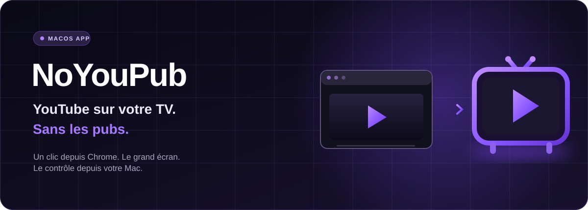

# NoYouPub 3.0 — beta

[Français](README.md)

NoYouPub sends a YouTube video from a Mac to a compatible TV's video player. The native macOS app and Chrome extension control the same local engine, **NoYouPub Core**. The extension still needs this engine when the app window is closed.

**Status: standalone beta candidate for Apple Silicon.** The local engine is bundled and targets macOS 14.0. Playback and controls were tested on macOS 14.3 with an LG webOS UP7750PTB. A clean Mac installation remains unverified. Gatekeeper can reject the ad hoc signature.

## Product capabilities

- Google Cast and DLNA discovery, TV selection, manual local-IP addition and diagnostics.
- **Fast** mode plays while downloading where supported. **Compatible** mode prepares a complete MP4 before playback. Startup time depends on available formats, connection and receiver.
- Pause, resume, stop, playback position, timeline seeking and sound controls where supported by the TV.
- Speeds 0.75×, 1×, 1.25×, 1.5×, 1.75× and 2×. On LG/DLNA the Mac adapts the stream through FFmpeg; a speed change can reload the TV player. Command support varies by receiver.
- Chrome queue: add from a video page or suggestions, remove, clear, next, previous and resume last playback. Chrome manages the queue and must remain open for automatic advancement.
- Independent navigation: watch another video on the Mac while the TV keeps playing; explicitly replace the TV video or add to the queue. Replies for a previous page are discarded.
- Preparation progress, cancellation, playback state synchronization and diagnostics.
- French and English, system detection and explicit language selection without reinstalling. Chrome can follow the app or retain its own preference; language selection works even without the bridge.

## How it works

The SwiftUI app invokes the Python Core. Chrome starts the same Core through origin-restricted Native Messaging. The engine discovers the receiver, prepares available media and serves a temporary, token-protected stream on the local network. The TV plays that media in its own player, rather than requiring the YouTube TV application.

Keep the Mac awake, online and able to reach the TV. No TV software is installed. This is not a Google or LG product. Extraction methods and media formats may change; not every video is guaranteed to work. Ad-free playback is not permission to access or use content.

## Installation and availability

- [Beta installation guide (French and English)](docs/BETA-INSTALLATION.md)
- [Project website](https://noyoupub.com)
- [GitHub Releases](https://github.com/Delavatitude/NoYouPub/releases)

This repository contains the project overview and installation guide. Source code and the DMG are pending distribution clearance.
