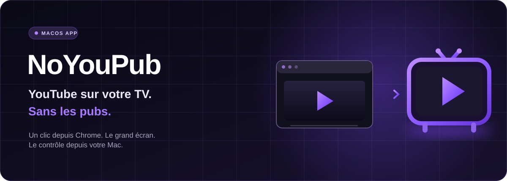

 

**Votre YouTube. Votre télévision. Vos règles.**

Une vidéo sur votre Mac. Un clic pour l'envoyer sur votre TV. Et toujours le contrôle à portée de main.

 

**Français** · [English](README.en.md)

---

## ▶ Regardez. Pas les pubs.

NoYouPub permet de diffuser des vidéos YouTube sur une télévision compatible **sans passer par l'application YouTube de la TV**. Vous trouvez votre vidéo sur votre Mac, vous l'envoyez sur grand écran et vous pilotez la lecture depuis votre ordinateur.

Les publicités classiques de l'application YouTube sont évitées par ce mode de lecture. Les passages sponsorisés **intégrés dans les vidéos** restent présents.

<table>
<tr>
<td width="33%" align="center"><h3>📺 Grand écran</h3>Une vidéo YouTube sur votre télévision depuis votre Mac.</td>
<td width="33%" align="center"><h3>⚡ Un clic</h3>Depuis Chrome, envoyez la vidéo sans copier son adresse.</td>
<td width="33%" align="center"><h3>🎛️ Le contrôle</h3>Pause, reprise, timeline et vitesse depuis votre Mac.</td>
</tr>
</table>

## ✨ Comment ça marche

<table>
<tr>
<td align="center" width="30%"><strong>▶️ YouTube</strong> Choisissez votre vidéo dans Chrome</td>
<td align="center" width="5%">➜</td>
<td align="center" width="30%"><strong>💜 NoYouPub</strong> Un clic pour lancer la diffusion</td>
<td align="center" width="5%">➜</td>
<td align="center" width="30%"><strong>📺 Votre TV</strong> Grand écran, contrôle depuis le Mac</td>
</tr>
</table>

NoYouPub comprend une application native macOS, une extension Chrome facultative et un moteur de diffusion local. **Le Mac doit rester allumé, éveillé et connecté au réseau pendant la lecture.**

## ⬇️ Installer NoYouPub

> [!IMPORTANT]
> **Version bêta pour Apple Silicon.** La première distribution est prévue **sans signature Developer ID ni notarisation Apple**. macOS peut bloquer l'ouverture initiale et demander une autorisation manuelle. Ne téléchargez l'application que depuis la page officielle des releases et vérifiez sa provenance.

1. Ouvrez les **[GitHub Releases](https://github.com/Delavatitude/NoYouPub/releases)**.
2. Téléchargez le fichier `NoYouPub-3.0.0-beta-arm64.dmg` lorsqu'il sera publié.
3. Ouvrez le DMG et installez l'application conformément aux instructions fournies.
4. Connectez votre Mac et votre télévision au **même réseau local**, puis lancez NoYouPub.
5. Collez un lien YouTube, choisissez la TV et lancez la diffusion.

Si macOS bloque l'application non notarisée, consultez les [instructions officielles d'Apple](https://support.apple.com/fr-fr/guide/mac-help/mh40616/mac). **Ne désactivez pas Gatekeeper globalement.**

L'extension Chrome apporte une expérience « un clic » directement dans YouTube ; son installation et sa disponibilité sont documentées dans le [centre d'aide](https://noyoupub.com/fr/aide).

## 📽️ Démo

**Trouver une vidéo → cliquer sur NoYouPub → regarder sur la TV → contrôler depuis le Mac**

[**Découvrir NoYouPub en action**](https://noyoupub.com)

## 🖥️ Compatibilité et limites

| | État de la bêta |
|---|---|
| **Mac** | Apple Silicon (`arm64`) ; build ciblant macOS 14.0, tests locaux réalisés sur macOS 14.3 |
| **Télévisions** | Détection LG/DLNA et Google Cast développée ; lecture, pause, reprise, déplacement, vitesse et arrêt testés sur LG webOS UP7750PTB |
| **Navigateur** | Chrome, avec extension locale (installation à documenter selon la release) |
| **Lecture** | Modes Rapide et Compatible ; qualité selon les pistes disponibles |
| **Réseau** | Mac et TV sur le même réseau ; Mac éveillé pendant la lecture |

Certaines vidéos protégées ou restreintes peuvent échouer. Les commandes et performances dépendent du récepteur.

## 🧩 Pour les développeurs

Ce dépôt présente le projet et son [guide d’installation](docs/BETA-INSTALLATION.md). La publication du code et du DMG reste en attente de la validation des droits de redistribution.

Le fonctionnement repose sur un moteur local : **pas besoin d'un serveur cloud pour relayer la lecture**.

## 💜 Pourquoi NoYouPub ?

Parce que chercher une vidéo sur son Mac est pratique. La regarder sur grand écran, encore mieux. NoYouPub rassemble les deux sans ajouter une interface compliquée.

### ☕ Soutenir NoYouPub

**NoYouPub est un projet gratuit, développé et maintenu indépendamment.**

Si l'application vous est utile et que vous souhaitez soutenir son développement, vous pouvez m'offrir un café. Chaque contribution aide à faire évoluer le projet et à le maintenir accessible gratuitement.

[**☕ Offrir un café**](https://buymeacoffee.com/louix)

### Prêt à passer au grand écran ?

[**Télécharger la bêta**](https://github.com/Delavatitude/NoYouPub/releases) · [**Voir le site**](https://noyoupub.com) · [**Consulter l'aide**](https://noyoupub.com/fr/aide)

Projet indépendant. Non affilié à YouTube, Google ou LG. Les marques appartiennent à leurs titulaires respectifs.

